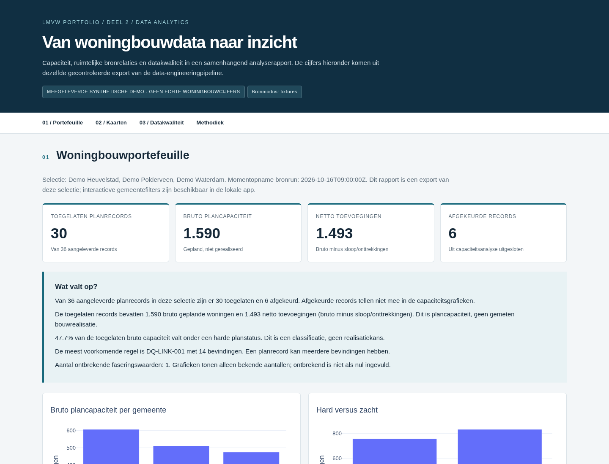

# LMVW | Housing Data Engineering & Analytics

**Python · REST APIs · Data Quality · GeoPandas/Shapely · Plotly · Streamlit**

A portfolio reconstruction of data integration and analytics work for a Dutch housing-monitoring tender. The goal is to show the **full data flow**: ingest housing plans, check their quality, retrieve BAG/BRK/DSO data, calculate spatial relationships, and turn the resulting tables into maps and dashboards.

This is a technical case study, **not** the official LMVW service. The supplied example is entirely synthetic. The original tender demo used INKIS/IO Factory; the Python quality checks and Python analytics interface here are independent reconstructions. See [NOTICE.md](NOTICE.md) for publication and ownership considerations.



## The end-to-end flow

```text
Housing plans (CSV/Excel)       BAG / BRK / DSO (API or synthetic fixtures)
             |                                 |
        ingestion.py                     source adapters
             |                                 |
        quality.py                         source tables
       /          \                            /
  DQ findings   valid plan polygons            /
       |                  \                    /
       |              geospatial.py  <--------+
       |                     |
       +-------> export.py (17 database-ready tables)
                             |
                       analytics/data.py
                             |
                 Plotly maps, charts and HTML
                    + local Streamlit app
```

- **Part 1 — Data Engineering (`pipeline/`)**: ingestion, standalone Python validation, REST API source adapters, geometry processing, relational CSV exports and SQL Server DDL.
- **Part 2 — Data Analytics (`analytics/`)**: plan-level KPIs, phasing and category breakdowns, linked-object maps, quality reporting, and a local Streamlit dashboard. The analytics layer reads the **same export** created by Part 1; it does not retrieve data separately.

## Quick start (offline, no API keys)

Requires **Python 3.11+**. Run from the repository root:

```bash
python -m pip install -r requirements.txt

# Complete pipeline: source fixtures -> quality -> geo matching -> HTML report
python -m pipeline.run run --config config.yaml --report

# Optional: open the interactive dashboard
python -m streamlit run analytics/app.py
```

The pipeline writes one new, private run folder:

```text
data/runs/<run-id>/
├── validation/            # DQ findings and rejected records
├── database_ready/        # 17 CSV tables + schema and manifest
└── report.html            # Interactive charts and vector maps
```

`data/runs/` is ignored by Git. The dashboard detects the latest run and also offers the bundled example; local runs require an explicit acknowledgement because they may contain confidential information.

Useful additional commands:

```bash
# Data Quality alone (exit code 2 if any records are rejected)
python -m pipeline.quality --config config.yaml

# Test the engineering and analytics code
python -m pip install pytest
python -m pytest -q

# Verify an example CSV export
python -m pipeline.run verify examples/output/database_ready

# Create a separate HTML report from a chosen export
python -m analytics.report --bundle examples/output/database_ready --output data/reports/portfolio.html
```

## Project structure

```text
pipeline/                  # 1. Engineering: read -> validate -> API -> spatial -> export
analytics/                 # 2. Analytics: KPIs, charts, HTML report, Streamlit app
examples/
  input/                   # One synthetic delivery and API-shaped source JSONs
  output/database_ready/   # One pre-generated export of the same input
  reports/                 # One pre-generated HTML report and screenshot
config.yaml                # Single config shared by the engineering flow
requirements.txt           # Dependencies for both parts
data/runs/                # Private runtime files (created locally; not committed)
tests/                     # Engineering and analytics tests in one place
```

There are **no duplicate example datasets** inside `analytics/` or `data/sample/`. `examples/input/` is the single example source; `examples/output/database_ready/` is its derived output. New runs are generated under `data/runs/` and never copied back into `examples/` automatically.

See [examples/README.md](examples/README.md) for the exact example files, their provenance and how to regenerate the output.

## Example results

The supplied synthetic delivery has **36 plan records** from three fictional municipalities. The Python validation rules accept **30** and quarantine **6**. The exported sample contains **17 relational CSV tables** and **318 plan–source relationships**. The example is deliberately constructed to demonstrate duplicate area keys, missing values, geometric issues and differences between candidate and confirmed spatial relationships.

- [Example interactive HTML report](examples/reports/report.html) — download and open locally; the Plotly library is embedded, with no map tile service.
- `examples/output/database_ready/plans.csv` — plan records and processing status.
- `examples/output/database_ready/dq_issues.csv` — quality and linking findings.
- `examples/output/database_ready/plan_bag_pand.csv`, `plan_brk_perceel.csv`, `plan_dso.csv` — spatial relationships.
- `examples/output/database_ready/schema.sql` — SQL Server DDL generated by the export code.

**Analytical rules:** capacity is aggregated at plan-record level rather than across many-to-many joined sources; rejected plans do not contribute to capacity figures. Unknown values are not silently replaced by zero. DSO candidate documents are not presented as substantively confirmed. Missing or disabled sources do not imply zero source coverage.

## Private data and live APIs

Never replace the tracked example CSV with actual LMVW deliveries. Use `data/private/` for input files and `data/runs/` for outputs (both Git-ignored). Do not publish their HTML reports, maps or CSVs: confidential plans can be disclosed by geographic boundaries or derived figures.

If your raw CSV has `Polygon_WKT` but lacks the explicit `CRS` field, **verify its CRS with the source owner**, then create a new metadata copy without changing the original values:

```bash
python -m pipeline.prepare_input data/private/plans_raw.csv data/private/plans_ready.csv --crs EPSG:28992
python -m pipeline.run validate --config config.yaml --plans data/private/plans_ready.csv
```

For real API enrichment, use a live run with authorized credentials and matching geographic coverage. Synthetic fixture JSONs cannot enrich arbitrary real plan geometries:

```bash
python -m pipeline.run run --config config.yaml --mode live --plans data/private/plans_ready.csv --report
```

DSO API keys are read at runtime through `DSO_API_KEY_PRE` or `DSO_API_KEY_PRODUCTION` (or the corresponding `_FILE` variables), **never from Git or `config.yaml`**. HTTPS/host checks, disabled redirects, bounded retries and redaction protections remain in the HTTP client. Previously exposed keys must be rotated. Actual live API operation and SQL Server loading have **not** been validated as part of this portfolio package.

## Scope and limitations

The Streamlit app runs locally, **without authentication or public-data authorisation**. No CBS microdata, ML predictions, real deployment, or publicly accessible service are provided. The report and dashboard are built outside INKIS and should not be presented as the original tender UI. Individual contributions should be distinguished from colleagues' work.
